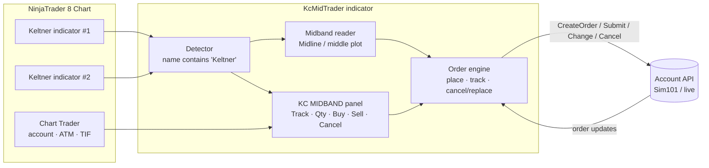

# KC-Mid-Trader-NinjaTrader

<i>Conceptualized and developed with AI by <b>Rangel Alvarado</b></i>

 <b>Brief Review<b>

**KC Mid Trader** is a NinjaTrader 8 indicator that adds a **KC MIDBAND** section to the bottom of **Chart Trader**. From there you can send Buy or Sell orders **attached to the midband of a Keltner Channel** with one click, keep them following the midband as it moves, and cancel them, without touching any of your other orders.

Main features:
- **Buy @ Mid / Sell @ Mid**: the order is placed at the current midband, rounded to the tick.
- **Track selector**: picks which Keltner indicator to follow when the chart has more than one. The first one listed is selected by default.
- **Own quantity**: a Qty box with ▲▼ arrows, set to 1 by default and independent of Chart Trader's *Order qty*.
- **Attached orders**: with *Track mid* on, working orders are re-priced each time the midband moves.
- **Cancel KC Orders**: cancels only the orders this tool placed.
- **Appears only when relevant**: the section is shown only while a visible indicator with *"Keltner"* in its name is on the chart.
- **Uses your Chart Trader setup**: the selected account and, optionally, the selected ATM strategy.

Below, the panel inside Chart Trader and what each control does.

The project tree:

| Path | Content |
|---|---|
| `KcMidTrader.cs` | NinjaScript indicator (the whole tool is this one file) |
| `docs/imgs/` | Figures, infographics and diagrams used in this README |
| `docs/man/` | Illustrated install and user guide in [English](docs/man/KcMidTrader_Manual_EN.pdf) and [Spanish](docs/man/KcMidTrader_Manual_ES.pdf) (PDF) |
| `docs/vids/` | Tracking demo ([MP4](docs/vids/kc_mid_tracking_demo.mp4) / [GIF](docs/vids/kc_mid_tracking_demo.gif)) |

 <b>How It Works<b>

The indicator looks for every visible Keltner-type indicator on the chart and reads the midband directly from that indicator's middle line, so the price always matches what you see. Orders go through NinjaTrader's Account API, using the account selected in Chart Trader.

Mermaid source (rendered natively by GitHub)

What happens when you click **Buy @ Mid**:

Life of an order placed by the tool:

| Label | Meaning |
|---|---|
| mid moved | The tick-rounded midband changed and *Track mid* is on, so the order is re-priced |
| crossed · Block | The midband moved to the other side of the market; tracking pauses at the last price |
| back · resume | The midband returned to the passive side; tracking resumes |
| crossed · StopMkt | With `SwitchToStopMarket`, the order is cancelled and, once the cancel is confirmed, re-submitted as a stop |
| touched | Price reached the order and it filled (now a position) |
| Cancel KC | The **Cancel KC Orders** button was clicked |

The order type depends on which side of the market the midband is on:

| Situation | Buy @ Mid | Sell @ Mid |
|---|---|---|
| Midband on the passive side (below the ask / above the bid) | **Buy Limit** at the midband | **Sell Limit** at the midband |
| Midband on the other side of the market | **Block** (default) or **Buy Stop Market** | **Block** (default) or **Sell Stop Market** |
| Midband exactly at the market | Not placed | Not placed |

 <b>Using KC Mid Trader<b>

**Requirements:** NinjaTrader 8 (desktop) and a data connection. Use **Sim101** or Playback to test.

- Download this repo, or clone it:
~~~
    git clone https://github.com/issaiass/KC-Mid-Trader-NinjaTrader
~~~
- Copy the indicator into the NinjaScript indicators folder:
~~~
    copy KcMidTrader.cs "%USERPROFILE%\Documents\NinjaTrader 8\bin\Custom\Indicators\"
~~~
- In NinjaTrader go to **Control Center → New → NinjaScript Editor** and press **F5** to compile. The bottom panel should show no errors.
- Open a chart and press **Ctrl+I**, then add:
    - a **KeltnerChannel** (or any indicator with *"Keltner"* in its name)
    - **KcMidTrader**
- Show **Chart Trader** from the chart toolbar. The **KC MIDBAND** section appears at the bottom.
- Typical workflow:

| # | Action | Result |
|---|---|---|
| 1 | Select the account (and the ATM, if wanted) in Chart Trader | KC orders use them; Chart Trader's *Order qty* is **not** used |
| 2 | Pick the channel in **Track** | Only needed when the chart has more than one Keltner indicator |
| 3 | Set **Qty** with ▲▼, the mouse wheel or by typing | Starts at *Default quantity* (1) |
| 4 | Leave **Track mid** checked | Orders follow the midband; uncheck to freeze them at their current price |
| 5 | Click **Buy @ Mid** or **Sell @ Mid** | The order goes in at the midband; the status line confirms it |
| 6 | Click **Cancel KC Orders** | Cancels the tool's working orders only |

> **Cancel vs. Close:** *Cancel KC Orders* only removes orders that have not filled. Once filled, manage the position with Chart Trader's native **Close** button or your ATM stops/targets.

**Settings** (Ctrl+I → KcMidTrader, group *KC Mid Trader*):

| Setting | Default | Meaning |
|---|---|---|
| Indicator name contains | `Keltner` | Indicators whose name contains this text are listed in **Track** |
| Default quantity | `1` | Starting value of Qty |
| Track midband by default | `On` | Initial state of *Track mid* |
| Track mode | `OnPriceChange` | `OnPriceChange` re-prices whenever the tick-rounded midband moves; `OnBarClose` re-prices once per bar |
| When midband crosses market | `Block` | `Block` pauses / refuses; `SwitchToStopMarket` cancels, then re-submits as a stop (never doubled) |
| Time in force | `GTC` | TIF for KC orders |
| Use Chart Trader ATM strategy | `On` | KC entries launch the ATM selected in Chart Trader |
| Re-adopt working KC orders on reload | `On` | Picks up non-ATM orders named `KCMid…` again after a reload |

The full step-by-step guide, with screenshots and troubleshooting, is in the manuals:

 <b>Results<b>

You can see KC Mid Trader running in NinjaTrader 8 in this YouTube video.

Last video update - KC Mid Trader for NinjaTrader 8:

An order placed with **Buy @ Mid** (a Buy Limit below price) follows the rising midband and fills when price pulls back into it.

Animated demo (simulated data):

<i>Click the image to open the MP4 version.</i>

The animated demo above is an illustration made with synthetic bars; the YouTube video shows the real tool in NinjaTrader 8.

 <b>Troubleshooting<b>

| Symptom | Check |
|---|---|
| The KC section does not appear | Is a **visible** indicator with "Keltner" in its name on the chart? Is Chart Trader visible, and is this the active chart tab? Open **New → NinjaScript Output**: the tool prints the indicators it sees on the chart |
| "Waiting for real-time data…" | The connection is not live yet or the market is closed; use the Sim or Playback connection |
| "Blocked: midband is above/below the market" | A limit there would fill immediately. Wait, or set *When midband crosses market* to `SwitchToStopMarket` |
| The order does not move | *Track mid* is unchecked, tracking is paused (see the status line), or *Track mode* is `OnBarClose` |
| Orders still working after removing the indicator | By design, a reload never cancels orders. Click **Cancel KC Orders** first |
| ATM orders not tracked after a reload | NinjaTrader names every ATM entry "Entry", so they can't be identified; cancel them from the chart or the Orders tab |
| Compile error in **another** file | NinjaTrader compiles all scripts together; fix or remove the script it names |

 <b>Issues<b>

- Adding controls to Chart Trader is **not an officially supported** NinjaTrader feature. It works through the WPF visual tree, and a future NinjaTrader update could change the internal control names.
- Tracking state lives in memory. After a reload, only non-ATM orders (named `KCMid…`) are re-adopted.
- With unrecognized line names, the midband is taken as the middle value of the indicator's first three lines.

 <b>Future Work<b>

Planning to add to this project:
- :heavy_check_mark: Chart Trader panel with Buy / Sell @ Mid and Cancel
- :heavy_check_mark: Orders attached to (tracking) the midband
- :heavy_check_mark: Selector for which Keltner indicator to track
- :heavy_check_mark: Bilingual manuals (EN / ES)
- :x: Right-click chart menu shortcuts (Buy / Sell LMT @ Mid)
- :x: Close KC position button
- :x: Offset in ticks from the midband
- :x: Attach to the upper / lower bands as well

 <b>Disclaimer<b>

This software sends and modifies real orders. It is provided for educational purposes, without any warranty. Trading futures and other leveraged products carries substantial risk of loss. **Always validate on the Sim101 account before using a live account.**

 <b>Contributing<b>

Your contributions are always welcome! Please feel free to fork and modify the content but remember to finally do a pull request.

 :iphone: <b>Having Problems?<b>

 <b>License<b>

