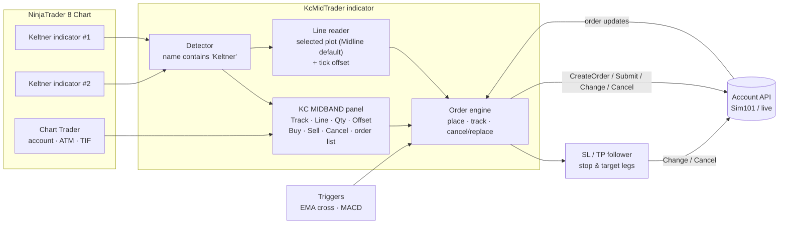

# KC-Mid-Traker-NinjaTrader

<i>Conceptualized and developed with AI by <b>Rangel Alvarado</b></i>

 <b>Brief Review<b>

**KC Mid Trader** is a NinjaTrader 8 indicator that adds a **KC MIDBAND** section to the bottom of **Chart Trader**. From there you can send Buy or Sell orders **attached to the midband of a Keltner Channel** (optionally a few ticks away from it) with one click, keep them following the line as it moves, and cancel them, without touching any of your other orders.

Main features:
- **Buy @ Midline / Sell @ Midline**: the order is placed at the selected line plus a tick offset, rounded to the tick.
- **Tick offset**: *Offset* (− / box / +) puts the buy *n* ticks **above** the line and the sell *n* ticks **below** it; 0 keeps the line price. **Show zone** draws it on the chart (light blue above, light red below).
- **Track + Line selectors**: *Track* picks the indicator (the first Keltner by default, locked until **Toggle track** is checked, which opens it to any indicator); *Line* picks the plot to follow (Midline by default, or Upper / Lower).
- **Attached orders**: working orders are re-priced each time the line (plus offset) moves.
- **EMA-cross and MACD triggers**: *Track* can also hold **EMA cross** (needs two EMAs) or a **MACD**. The Buy or Sell stays *not filled* until the cross, then goes in at the Keltner line (see [Advanced](#advanced-sl--tp-ema-cross-and-macd)).
- **Three order lists**: **Not filled**, **Filled** and **Completed** (W / L with points). Chart Trader *Mkt / Bid / Ask* orders are listed too.
- **SL / TP**: on one checked filled order, keep the ATM, remove a leg, make it follow an indicator, close the target on an EMA cross, or close on a MACD level.
- **Own quantity**: a Qty box with ▲▼ arrows, set to 1 by default and independent of Chart Trader's *Order qty*.
- **ATM-aware**: changing the ATM strategy cancels and re-submits unfilled entries with the new template, and re-prices the stop/target of the filled orders you check.
- **Cancel KC Orders**: cancels only the orders this tool placed.
- **Appears only when relevant**: the section is shown only while a visible indicator with *"Keltner"* in its name is on the chart.

Below, the panel inside Chart Trader and what each control does.

The project tree:

| Path | Content |
|---|---|
| `KcMidTrader.cs` | NinjaScript indicator (the whole tool is this one file) |
| `docs/imgs/` | Figures, infographics and diagrams used in this README |
| `docs/man/` | Illustrated install and user guide in [English](docs/man/KcMidTrader_Manual_EN.pdf) and [Spanish](docs/man/KcMidTrader_Manual_ES.pdf) (PDF) |
| `docs/vids/` | Tracking demo ([MP4](docs/vids/kc_mid_tracking_demo.mp4) / [GIF](docs/vids/kc_mid_tracking_demo.gif)) |

 <b>How It Works<b>

The indicator looks for every visible Keltner-type indicator on the chart and reads the selected line (the midband by default) directly from that indicator's plot, then adds the tick offset, so the price always matches what you see. Orders go through NinjaTrader's Account API, using the account selected in Chart Trader.

Mermaid source (rendered natively by GitHub)

What happens when you click **Buy @ Midline**:

Life of an order placed by the tool:

| Label | Meaning |
|---|---|
| line moved | The tick-rounded order price (line ± offset) changed and *Track line* is on, so the order is re-priced |
| crossed · Block | The order price moved to the other side of the market; tracking pauses at the last price |
| back · resume | The order price returned to the passive side; tracking resumes |
| crossed · StopMkt | With `SwitchToStopMarket`, the order is cancelled and, once the cancel is confirmed, re-submitted as a stop |
| touched | Price reached the order and it filled (now a position) |
| Cancel KC | The **Cancel KC Orders** button was clicked |

The order type depends on which side of the market the order price (line ± offset) is on:

| Situation | Buy @ Midline | Sell @ Midline |
|---|---|---|
| Order price on the passive side (below the ask / above the bid) | **Buy Limit** | **Sell Limit** |
| Order price on the other side of the market | **Block** (default) or **Buy Stop Market** | **Block** (default) or **Sell Stop Market** |
| Order price exactly at the market | Not placed | Not placed |

**Offset:** the buy price is `line + n ticks`, the sell price is `line − n ticks` (rounded to the tick). *Max ticks offset* (default 100) only trims a typed value in the Offset box; it is never added to the line.

**Order lists:** each order gets a label like `Ord-af3658-Nov-10-26_09-31-02-114-BUY-1-NF`. Orders sit in one of three lists:

| List | Meaning |
|---|---|
| **Not filled** (`NF`) | Working or armed orders. Unfilled entries are cancelled and re-submitted when the ATM strategy changes |
| **Filled** (`F`) | Open fills, with a checkbox. Checked ones have their ATM stop/target re-priced on an ATM change; check **one** to enable **SL / TP** |
| **Completed** | Closed trades such as `…-F-W-5.25` or `…-F-L-4.75`. `W` = win, `L` = loss, the last number is points (4 ticks = 1 point) |

 <b>Using KC Mid Trader<b>

**Requirements:** NinjaTrader 8 (desktop) and a data connection. Use **Sim101** or Playback to test.

- Download this repo, or clone it:
~~~
    git clone https://github.com/issaiass/KC-Mid-Traker-NinjaTrader
~~~
- Copy the indicator into the NinjaScript indicators folder:
~~~
    copy KcMidTrader.cs "%USERPROFILE%\Documents\NinjaTrader 8\bin\Custom\Indicators\"
~~~
- In NinjaTrader go to **Control Center → New → NinjaScript Editor** and press **F5** to compile. The bottom panel should show no errors.
- Open a chart and press **Ctrl+I**, then add:
    - a **KeltnerChannel** (or any indicator with *"Keltner"* in its name)
    - **KcMidTrader**
- Show **Chart Trader** from the chart toolbar. The **KC MIDBAND** section appears at the bottom.
- Typical workflow:

| # | Action | Result |
|---|---|---|
| 1 | Select the account (and the ATM, if wanted) in Chart Trader | KC orders use them; Chart Trader's *Order qty* is **not** used |
| 2 | Pick the indicator in **Track** and the plot in **Line** | Only needed with several Keltner indicators or to follow Upper / Lower. *Track* is locked until **Toggle track** is checked |
| 3 | Set **Qty** with ▲▼, the mouse wheel or by typing | Starts at *Default quantity* (1) |
| 4 | Set **Offset** with − / +, typing or the wheel | Buy *n* ticks above the line, sell *n* ticks below; 0 = on the line. **Show zone** draws it |
| 5 | Use **Track line** and **Show zone** to save space | Unchecking *Track line* hides the Track and Line rows; unchecking *Show zone* hides the Offset row. Orders keep following the line and the offset keeps applying either way |
| 6 | Click **Buy @ Midline** or **Sell @ Midline** | The order goes in at line ± offset; the status line confirms it and the order shows in *Not filled* as `…-NF` |
| 7 | Click **Cancel KC Orders** | Cancels the tool's working orders only |
| 8 | Check **one** filled order, then click **SL / TP** | Opens the stop-and-target window (see below). Closed trades move to *Completed* |

> **Cancel vs. Close:** *Cancel KC Orders* only removes orders that have not filled. Once filled (F), manage the position with Chart Trader's native **Close** button or your ATM stops/targets.

**Settings** (Ctrl+I → KcMidTrader, group *KC Mid Trader*):

| Setting | Default | Meaning |
|---|---|---|
| Indicator name contains | `Keltner` | Indicators whose name contains this text are listed in **Track** |
| Default quantity | `1` | Starting value of Qty |
| Track line by default | `On` | Initial state of the *Track line* checkbox (shows the Track and Line rows) |
| Track mode | `OnPriceChange` | `OnPriceChange` re-prices whenever the tick-rounded order price moves; `OnBarClose` re-prices once per bar |
| When midband crosses market | `Block` | `Block` pauses / refuses; `SwitchToStopMarket` cancels, then re-submits as a stop (never doubled) |
| Time in force | `GTC` | TIF for KC orders |
| Use Chart Trader ATM strategy | `On` | KC entries launch the ATM selected in Chart Trader |
| Max ticks offset | `100` | Ceiling for the Offset box only; a typed value above it is trimmed to it |
| Re-adopt working KC orders on reload | `On` | Picks up non-ATM orders named `KCMid…` again after a reload |

The full step-by-step guide, with screenshots and troubleshooting, is in the manuals:

 <b>Advanced: SL / TP, EMA cross and MACD<b>

**SL / TP window** (check exactly one filled order, then click **SL / TP**). Each leg, stop and target, has its own source:

| Leg source | Effect |
|---|---|
| ATM strategy | Leave the leg on the ATM template |
| None | Remove the stop or the target. **The position stays open** |
| Indicator + plot | The leg follows that plot (pick the band in the second list) |
| EMA cross *(target only)* | Needs two EMAs. The target closes the position when EMA A crosses EMA B |
| MACD + **Value** | Closes the position when the absolute MACD level falls through the value. At 0: a buy closes when MACD crosses down through 0, a sell when it crosses up |

**Triggers chosen in Track:**

| Track entry | How it works |
|---|---|
| **EMA cross** | Needs two EMAs; a window asks for EMA A and EMA B. Buy stays *not filled* until A crosses **above** B, Sell until A crosses **below** B. Then the entry goes in, the ATM stop is kept and the target waits for the next cross. *Line* shows `Cross` |
| **MACD** | A window asks for a magnitude. The order price stays the Keltner line chosen in *Line*; MACD is only the trigger. Buy waits for MACD to cross **above** the value, Sell for a cross **below**; then a limit is sent at the Keltner line and the ATM starts |

> EMA and MACD crosses use the **closed bar** only. A cross that is **already true** does not open or close anything; it must leave and cross again.

 <b>Results<b>

You can see KC Mid Trader running in NinjaTrader 8 in this YouTube video.

Last video update - KC Mid Trader for NinjaTrader 8:

An order placed with **Buy @ Midline** (offset 0, a Buy Limit below price) follows the rising midband and fills when price pulls back into it.

Animated demo (simulated data):

<i>Click the image to open the MP4 version.</i>

The animated demo above is an illustration made with synthetic bars; the YouTube video shows the real tool in NinjaTrader 8.

 <b>Troubleshooting<b>

| Symptom | Check |
|---|---|
| The KC section does not appear | Is a **visible** indicator with "Keltner" in its name on the chart? Is Chart Trader visible, and is this the active chart tab? Open **New → NinjaScript Output**: the tool prints the indicators it sees on the chart |
| "Waiting for real-time data…" | The connection is not live yet or the market is closed; use the Sim or Playback connection |
| "Blocked: order price … the market" | A limit there would fill immediately (line plus offset is on the wrong side). Wait, lower the offset, or set *When midband crosses market* to `SwitchToStopMarket` |
| The Track list is greyed out or missing | Greyed: locked on the Keltner indicator by design; check **Toggle track** to pick another. Missing: *Track line* is unchecked, which hides the Track and Line rows (*Show zone* hides the Offset row) |
| The Offset box trims my number | A value above *Max ticks offset* (100) is trimmed; raise the setting |
| The order does not move | Tracking is paused (see the status line), *Track mode* is `OnBarClose`, or an EMA / MACD order is still armed (it has no broker order until its cross) |
| Orders still working after removing the indicator | By design, a reload never cancels orders. Click **Cancel KC Orders** first |
| ATM orders not tracked after a reload | NinjaTrader names every ATM entry "Entry", so they can't be identified; cancel them from the chart or the Orders tab |
| Compile error in **another** file | NinjaTrader compiles all scripts together; fix or remove the script it names |

 <b>Issues<b>

- Adding controls to Chart Trader is **not an officially supported** NinjaTrader feature. It works through the WPF visual tree, and a future NinjaTrader update could change the internal control names.
- Tracking state lives in memory. After a reload, only non-ATM orders (named `KCMid…`) are re-adopted.
- With unrecognized line names, the midband is taken as the middle value of the indicator's first three lines.
- The header comment inside `KcMidTrader.cs` still says "stock Keltner Channel" and "recomputed internally"; the code now reads the plot of any visible indicator whose name contains the filter text.

 <b>Future Work<b>

Planning to add to this project:
- :heavy_check_mark: Chart Trader panel with Buy / Sell @ Midline and Cancel
- :heavy_check_mark: Orders attached to (tracking) the midband
- :heavy_check_mark: Offset in ticks from the line, with a drawn zone
- :heavy_check_mark: Selectable line (Midline / Upper / Lower) and any-indicator tracking (Toggle track)
- :heavy_check_mark: KC order lists (Not filled / Filled / Completed with W / L points) and ATM-change handling
- :heavy_check_mark: SL / TP window, EMA-cross and MACD triggers
- :heavy_check_mark: Selector for which Keltner indicator to track
- :heavy_check_mark: Bilingual manuals (EN / ES)
- :x: Right-click chart menu shortcuts (Buy / Sell LMT @ Mid)
- :x: Close KC position button

 <b>Disclaimer<b>

This software sends and modifies real orders. It is provided for educational purposes, without any warranty. Trading futures and other leveraged products carries substantial risk of loss. **Always validate on the Sim101 account before using a live account.**

 <b>Contributing<b>

Your contributions are always welcome! Please feel free to fork and modify the content but remember to finally do a pull request.

 :iphone: <b>Having Problems?<b>

 <b>License<b>

